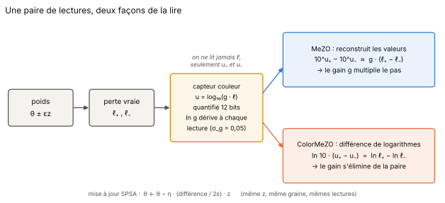
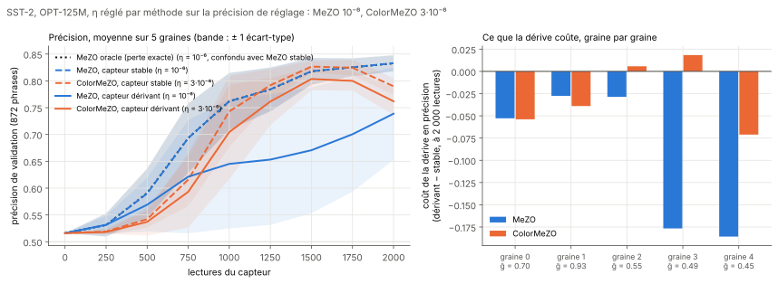
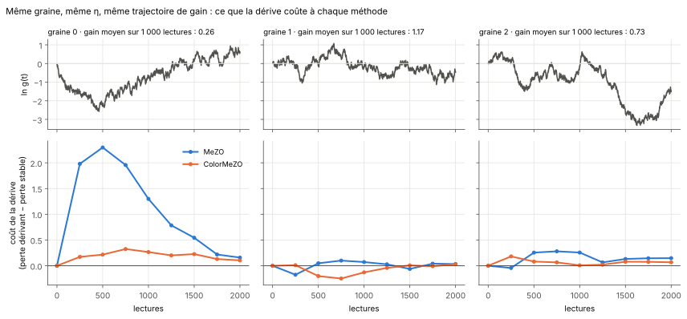
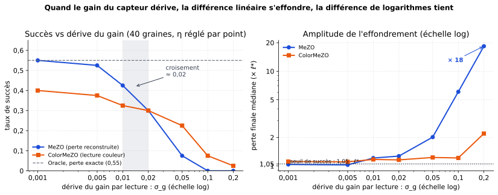

# ColorMeZO

Ce travail transpose la lecture « couleur » du projet
[complex-colorimetry-optimization](https://github.com/mathisfrinzi/complex-colorimetry-optimization) à MeZO, le
fine-tuning de LLM par passes avant seulement (Malladi et al., 2023), et le mesure d'un réseau jouet de 12 paramètres
jusqu'à OPT-125M sur SST-2.

MeZO estime un gradient avec deux passes avant, `θ + εz` et `θ − εz`, et la différence des deux pertes. Ce dépôt étudie le
cas où la perte n'est **jamais lue directement** : elle passe par un capteur qui rend `u = log10(g·ℓ)`, quantifié sur
12 bits, dont le gain `g` est inconnu et dérive à chaque lecture. MeZO reconstruit les valeurs et en fait la différence ;
**ColorMeZO** fait la différence des logarithmes, d'où le gain s'élimine.



## En bref

> **Sous gain dérivant, ColorMeZO paie peu la dérive et MeZO la paie au prorata du gain moyen, du jouet jusqu'à OPT-125M
> sur SST-2. La robustesse n'en fait pas l'optimum : ColorMeZO reste sous l'oracle.** Sur le LLM, à η réglé par méthode
> (5 graines, jeu de test), la dérive coûte 9,4 points de précision à MeZO et 2,8 à ColorMeZO après 2 000 lectures, mais
> ColorMeZO dérivant finit à 0,762 de précision contre 0,833 pour l'oracle.

- **Sur le LLM réel** (partie 5 ; OPT-125M, SST-2, 2 000 lectures), le système complet apprend : la précision passe de
  0,516 à 0,83 pour MeZO à son meilleur η. À capteur stable, MeZO égale l'oracle à 3·10⁻³ près. Sous dérive, MeZO décroche
  sur 2 graines sur 5 (0,62 et 0,64) ; ColorMeZO reste entre 0,73 et 0,80, avec un écart-type inter-graines 3,4 fois plus
  petit. En perte, la dérive lui coûte 8 fois moins (+0,06 contre +0,52), et il est le moins pénalisé sur 4 graines sur 5.

  

- **Le mécanisme est un pas réel différent.** MeZO avance de `η·g(t)` : MeZO sous dérive se comporte comme MeZO stable
  avec η × gain moyen (écart médian de 0,05 en perte). ColorMeZO avance de `η/ℓ(t)` : son meilleur η est 3 fois celui de
  MeZO (3·10⁻⁶ contre 10⁻⁶), et son pas grandit quand la perte baisse. À gain stable, il descend plus bas en perte que
  l'oracle (0,646 contre 0,867), mais sa précision culmine vers 1 500 lectures puis recule (0,790 contre 0,833 à la fin).
- **MeZO sous dérive diverge, ColorMeZO jamais.** À η = 10⁻⁴, MeZO dérivant produit des valeurs non finies sur les deux
  graines de réglage (MeZO stable reste fini) ; à 10⁻⁵, il explose sur 2 graines finales sur 3, chaque fois quand le gain
  remonte au-dessus de 1. ColorMeZO reste fini à tous les η testés.

  

- **Sur le jouet** (parties 1 à 4 ; professeur-élève, 12 paramètres, 20 à 40 graines), la différence est plus brutale :
  à dérive par lecture, MeZO tombe à 1/20 succès quand ColorMeZO en garde 6/20 ; MeZO s'effondre dès σ_g ≈ 0,02 par
  lecture, ColorMeZO tient jusqu'à 0,1.

  

- **La phase** (partie 6). Une évaluation en `θ + iεz` donne une phase `≈ ε·∂ℓ/ℓ`, la pente de ColorMeZO, d'où un gain
  réel positif disparaît sans paire. Sur le jouet (50 graines), elle est exactement insensible à la dérive. À coût
  numérique égal, elle fait jeu égal avec ColorMeZO (15/50 contre 12/50) ; si un capteur la mesurait en une lecture, elle
  approcherait l'oracle (23/50 contre 29/50). L'estimateur par pas complexe est déjà publié (Jongeneel, Yue et Kuhn).
- **Ce que la lecture couleur ne fait pas.** Elle ne bat pas la valeur à gain stable : l'oracle reste devant sur le
  jouet (11/20 en ~1 600 lectures contre 7/20 en ~3 300) comme sur le LLM. Le re-étalonnage « geo » comble l'écart à gain
  stable mais perd la robustesse dès σ_g ≈ 0,02. Les méthodes à classement (ES par rangs) sont déjà insensibles à
  l'échelle et restent la meilleure méthode robuste du jouet (0,50 contre 0,30 pour ColorMeZO).
- **Ce qui a été corrigé en route** ([fausses pistes](rapport/fausses_pistes.md)). Une première campagne, où une borne de
  norme écrêtait 80 % des pas, n'a rien départagé. Le critère de réglage prévu (la perte après 1 000 lectures) retenait des
  η qui atteignent un plateau où le modèle ignore la phrase ; les η de la finale viennent de la précision de réglage. Sur
  le jeu de réglage, ColorMeZO sous dérive semblait égaler l'oracle ; la finale sur le jeu de test ne l'a pas confirmé.

## Le rapport

| | Partie | Ce qui est mesuré | Figure |
|---|---|---|---|
| 0 | [Introduction](rapport/0_introduction.md) | le capteur, MeZO et ColorMeZO, le protocole commun | [principe](figures/schema_principe.svg) |
| 1 | [Le jouet : la dérive casse MeZO](rapport/1_jouet.md) | 12 paramètres, capteur dérivant contre stable | |
| 2 | [Où l'avantage disparaît](rapport/2_derive.md) | balayage de σ_g, dérive par pas, méthodes à population | [croisement](figures/e2_croisement.svg) |
| 3 | [Re-étalonner sans perdre la robustesse ?](rapport/3_reetalonnage.md) | ColorMeZO-geo, la frontière avec la dérive | [frontière](figures/e3_frontiere_geo.svg) |
| 4 | [À armes égales](rapport/4_armes_egales.md) | Adam, Broyden, BFGS, Nelder-Mead, ES sur le même capteur | [toutes les méthodes](figures/e4_toutes_methodes.svg) |
| 5 | [Sur un LLM réel : OPT-125M et SST-2](rapport/5_llm.md) | pilote, campagnes à η égal et sur 9 valeurs de η, finale à η réglé sur 5 graines | [finale](figures/llm_finale_5graines.svg) |
| 6 | [La phase : lire la pente dans la teinte](rapport/6_phase.md) | une évaluation complexe au lieu d'une paire, 50 graines, ce qui existe déjà | [phase](figures/phase_jouet.svg) |
| 7 | [Synthèse](rapport/7_synthese.md) | ce qui tient, les limites, le lien avec la théorie et l'existant | [pas effectif](figures/schema_pas_effectif.svg) |
| | [Fausses pistes et corrections](rapport/fausses_pistes.md) · [Suite](rapport/suite.md) · [Reproduire](rapport/reproduire.md) | | |

Chaque partie commence par « ce qu'il faut retenir » et se termine par un bilan : ce qui marche, les limites.

## Reproduire

```bash
pip install -r requirements.txt     # numpy, scipy, matplotlib
python3 src/bench_colormezo.py      # partie 1, ~30 s CPU
python3 src/bench_sweep.py          # partie 2
python3 src/bench_etude3.py         # partie 3
python3 src/bench_etude4.py         # partie 4
python3 src/bench_phase.py          # partie 6, ~3 min 20 CPU
python3 src/figures_rapport.py      # schémas et figures, à partir des résultats enregistrés
```

La campagne LLM tourne sur GPU dans [`campagne-llm/colormezo_llm_sst2.ipynb`](campagne-llm/colormezo_llm_sst2.ipynb)
(Colab ; ~2 h mesurées pour les deux grilles de réglage, 52 min pour la finale à 5 graines avec `MODE_FINALE = True`).
Chaque run est sauvegardé et la reprise après déconnexion est automatique. Le détail est dans
[rapport/reproduire.md](rapport/reproduire.md).

## Organisation

```
colormezo/
├── README.md             # cette page
├── rapport/              # le rapport, un fichier par partie
├── src/                  # bancs du jouet (parties 1 à 4 et 6) et figures du rapport
├── results/              # résultats bruts du jouet (JSON)
├── pilot-llm/            # pilote OPT-125M en NumPy pur, sans PyTorch (1 puis 5 graines)
├── campagne-llm/         # carnet Colab de la campagne SST-2 et ses résultats (JSON)
├── campaign/             # variante CPU de la campagne SST-2, scriptée mais non exécutée
└── figures/              # schémas et figures (SVG)
```

## Licence

Code MIT, textes CC BY 4.0.
