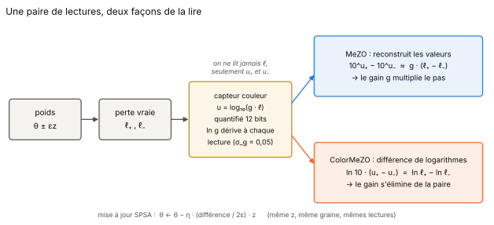
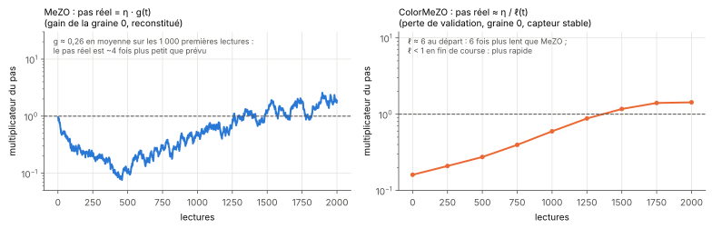

[Sommaire](../README.md#le-rapport) · [Partie 1 →](1_jouet.md)

# Introduction : lire une perte à travers un capteur qui ment sur l'échelle

**La question.** MeZO (Malladi et al., 2023) entraîne un réseau sans rétropropagation : il perturbe tous les poids dans une
direction aléatoire `z`, lit la perte en `θ + εz` et en `θ − εz`, et avance dans la direction `z` en proportion de la
différence. Tout repose sur la **différence de deux valeurs**. Que se passe-t-il quand on ne lit pas la perte elle-même,
mais une mesure dont l'échelle est inconnue et change d'une lecture à l'autre ? Le projet couleur
([complex-colorimetry-optimization](https://github.com/mathisfrinzi/complex-colorimetry-optimization)) avait montré
qu'une lecture « couleur » (une luminosité ∝ `log|f|`, connue à une décennie près) ne donne jamais la valeur de `f`, mais
suffit à reconstituer des **rapports**. Ce rapport mesure si ce régime, où l'échelle manque, est celui où la lecture
couleur devient utile à une méthode d'ordre zéro.



## Le plan

| Partie | Ce qui est mesuré | Fichier |
|---|---|---|
| 1 | le jouet (12 paramètres) : MeZO et ColorMeZO sur capteur dérivant et stable | [1_jouet.md](1_jouet.md) |
| 2 | où l'avantage disparaît : balayage de la dérive, dérive par pas, méthodes à population | [2_derive.md](2_derive.md) |
| 3 | re-étalonner la lecture couleur pour rattraper l'oracle | [3_reetalonnage.md](3_reetalonnage.md) |
| 4 | toutes les méthodes classiques sur le même capteur | [4_armes_egales.md](4_armes_egales.md) |
| 5 | **un LLM réel** : OPT-125M, pilote puis campagnes sur SST-2, finale à η réglé | [5_llm.md](5_llm.md) |
| 6 | la phase d'une évaluation complexe : la pente sans paire | [6_phase.md](6_phase.md) |
| 7 | synthèse, limites, lien avec la théorie et l'existant | [7_synthese.md](7_synthese.md) |

## Le capteur

Toutes les méthodes « capteur » lisent la même chose :

```
u = log10( g · ℓ )   quantifié sur 12 bits (pas de 1/4096 en u),
ln g ← ln g + N(0, σ_g²)   à chaque lecture (marche aléatoire, σ_g = 0,05 sauf balayage),
la décennie est connue.
```

Le capteur ne rend jamais `ℓ`. Le gain part de 1 ; sur 2 000 lectures, `ln g` se promène typiquement de ±2 (écart-type σ_g·√2 000 ≈ 2,2 : le
gain varie d'un facteur 0,1 à 10 environ ; sur les cinq graines finales du LLM, |ln g| atteint 1,1 à 3,6). La décennie connue est un cadeau fait à MeZO : sans elle, il ne pourrait pas reconstruire de valeur
du tout. Le banc est donc *généreux* avec MeZO.

## Les méthodes

Une paire de lectures `u₊` (en `θ + εz`) et `u₋` (en `θ − εz`) ; la mise à jour est toujours `θ ← θ − η · γ · z`.

| Nom | Ce qu'il fait de la paire | Pente γ | Ce que le gain devient |
|---|---|---|---|
| **MeZO oracle** | lit la perte exacte | `(ℓ₊ − ℓ₋) / 2ε` | pas de capteur |
| **MeZO capteur** | reconstruit les valeurs `10^u` | `(10^u₊ − 10^u₋) / 2ε ≈ g · ∂ℓ` | il multiplie le pas |
| **ColorMeZO** | différence de logarithmes, dépliée à ± 0,5 décennie | `ln10 · (u₊ − u₋) / 2ε ≈ ∂ℓ / ℓ` | il s'élimine de la paire |
| **ColorMeZO-geo** (partie 3) | ColorMeZO × moyenne géométrique `√(10^u₊ · 10^u₋)` | `≈ g · ∂ℓ` | il revient |

Deux conséquences, qui organisent tout le rapport :

- **MeZO avance de `η · g(t)`.** Si le gain dérive vers le bas, le pas réel rétrécit ; vers le haut, il grandit et peut
  diverger. De plus, `g` change entre `u₊` et `u₋` : la différence contient un terme `ℓ · (g₊ − g₋)` qui n'a rien à voir avec
  le gradient.
- **ColorMeZO avance de `η / ℓ(t)`.** C'est un gradient *relatif* : lent loin du minimum quand la perte est grande, plus
  rapide quand elle est petite. Le gain n'y entre pas, sauf par le bruit de dérive entre les deux lectures d'une même paire.



## Le protocole commun

- **Mêmes lectures pour tous** : pour une graine donnée, toutes les méthodes voient les mêmes directions `z`, les mêmes
  minibatchs et la même trajectoire de gain. Les comparaisons sont **appariées**.
- **η réglé par méthode** sur des graines de réglage distinctes des graines de test.
- **Contrôles** : chaque méthode capteur est aussi mesurée à **gain stable** (`g = 1`). Cela sépare ce qui vient de la dérive
  de ce qui vient de la quantification ou de la forme de la pente.
- Les questions et les prédictions de chaque étude ont été écrites dans les scripts avant les campagnes ; les écarts au plan
  sont signalés dans les [fausses pistes](fausses_pistes.md).

---

[Sommaire](../README.md#le-rapport) · [Partie 1 →](1_jouet.md)
