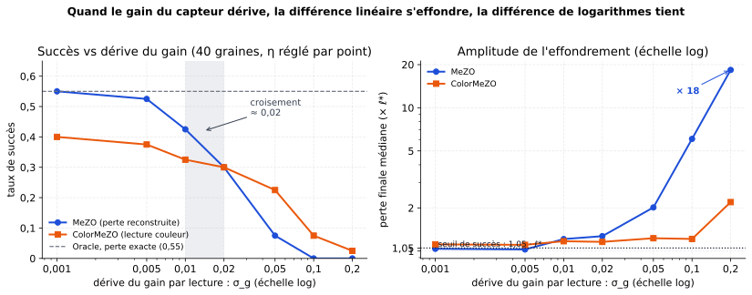
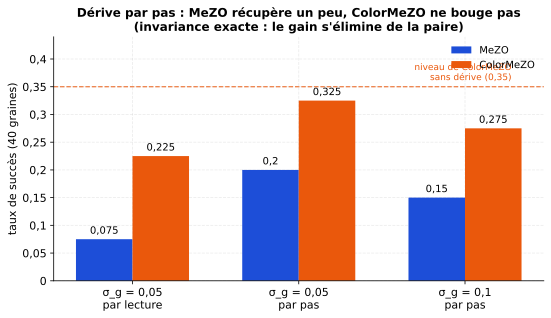

[Sommaire](../README.md#le-rapport) · [← Partie 1](1_jouet.md) · [Partie 3 →](3_reetalonnage.md)

# Partie 2. Où l'avantage disparaît

> **Ce qu'il faut retenir**
>
> - En balayant la dérive, les courbes se croisent vers **σ_g ≈ 0,02 par lecture** : en dessous, MeZO capteur gagne ;
>   au-dessus, seule la lecture couleur garde des succès. À σ_g = 0,1, MeZO est à 0 et ColorMeZO à 0,07.
> - Quand le gain ne dérive qu'**entre deux pas** (constant dans une paire), ColorMeZO est **exactement** à son niveau sans
>   dérive (0,33) ; MeZO récupère en partie (0,20) mais reste battu.
> - Les méthodes à population (ES) sont déjà insensibles à l'échelle : **ColorES n'a rien à apporter**.

Même tâche et même critère qu'en [partie 1](1_jouet.md), 40 graines de test, η re-réglé à chaque point
(`src/bench_sweep.py`).

## 2.1 Dérive par lecture : le croisement

Taux de succès sur 40 graines :

| σ_g par lecture | 0,001 | 0,005 | 0,01 | 0,02 | 0,05 | 0,1 | 0,2 |
|:---|:---:|:---:|:---:|:---:|:---:|:---:|:---:|
| MeZO capteur | **0,55** | **0,53** | **0,42** | 0,30 | 0,07 | 0,00 | 0,00 |
| ColorMeZO | 0,40 | 0,38 | 0,33 | 0,30 | **0,23** | **0,07** | **0,03** |

Les deux méthodes se dégradent : une dérive par lecture ajoute à chaque paire un bruit d'écart-type σ_g (un tirage sépare les
deux lectures) que la lecture couleur subit aussi. Mais MeZO tombe à zéro dès σ_g = 0,1, quand ColorMeZO garde encore des succès. Le croisement est à
σ_g ≈ 0,02. (Oracle sur les mêmes 40 graines : 0,55.)

## 2.2 Dérive par pas : l'invariance exacte

Ici le gain est constant à l'intérieur d'une paire et dérive d'un pas au suivant. La différence des logarithmes vaut alors
exactement `ln ℓ₊ − ln ℓ₋` : ColorMeZO ne voit plus du tout la dérive.

| Régime | MeZO capteur | ColorMeZO |
|:---|:---:|:---:|
| dérive par lecture, σ_g = 0,05 | 0,07 | 0,23 |
| **dérive par pas**, σ_g = 0,05 | 0,20 | **0,33** |
| **dérive par pas**, σ_g = 0,1 | 0,15 | **0,28** |

- **ColorMeZO à 0,33, c'est son niveau sans dérive** : l'invariance est exacte, pas approchée.
- **MeZO récupère en partie** (0,20 contre 0,07) : le gain ne biaise plus la direction, mais il fixe l'échelle du pas, et
  `ln g` se promène de ±σ_g·√3 000 sur la course.

## 2.3 Les méthodes à population : la niche est vide

ES à 4 paires antithétiques (8 lectures par pas), 20 graines, σ_g = 0,05 par lecture :

| Variante | Succès | Ratio médian |
|:---|:---:|:---:|
| ES par valeurs, capteur stable | **0,55** | 1,04 |
| ES par valeurs, capteur dérivant | 0,45 | 1,09 |
| ES par rangs, capteur dérivant | 0,50 | 1,06 |

L'ES par valeurs atteint l'oracle à gain stable et tient presque sous dérive ; l'ES par rangs fait mieux encore.
Standardiser les lectures d'une génération, ou ne garder que leur ordre, supprime déjà l'échelle. **L'avantage de la lecture
couleur est propre aux méthodes à différences (SPSA, MeZO)**, pas aux méthodes qui classent une génération.

Résultats bruts : [`results/bench_sweep.json`](../results/bench_sweep.json).

## 2.4 Bilan de la partie 2

**Ce qui marche.** Dès σ_g ≥ 0,02 par lecture, seule la lecture couleur garde des succès ; à dérive par pas, ColorMeZO est
exactement insensible.

**Les limites.**
- Une seule tâche, m = 12 : la valeur du croisement (0,02) et l'invariance par pas restent à confirmer ailleurs (la
  partie 5 le fait pour la dérive par lecture, sur un LLM).
- À faible dérive, MeZO garde son avance : la lecture couleur n'est pas un choix par défaut.

---

[Sommaire](../README.md#le-rapport) · [← Partie 1](1_jouet.md) · [Partie 3 →](3_reetalonnage.md)
