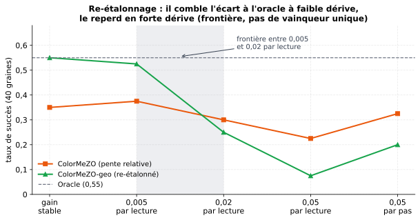

[Sommaire](../README.md#le-rapport) · [← Partie 2](2_derive.md) · [Partie 4 →](4_armes_egales.md)

# Partie 3. Re-étalonner sans perdre la robustesse ?



> **Ce qu'il faut retenir**
>
> - Multiplier la pente couleur par la moyenne géométrique des deux lectures (**ColorMeZO-geo**) comble **tout** l'écart à
>   l'oracle à gain stable : 0,55 succès en 1 675 lectures, contre 0,55 en 1 663 pour l'oracle.
> - Mais en forte dérive, geo retombe **exactement** au niveau de MeZO (0,075 contre 0,07) : en remettant l'échelle, on remet
>   le gain.
> - La frontière est étroite, entre σ_g = 0,005 et 0,02 par lecture. La lecture couleur ne bat jamais la valeur.

## 3.1 L'idée

Le facteur ~2 de la [partie 1](1_jouet.md) vient de ce que ColorMeZO suit `∂ℓ/ℓ`. La même paire de lectures permet de
reconstruire la pente de MeZO :

```
ℓ_geo = √(10^u₊ · 10^u₋)        γ_geo = (δ ln ℓ / 2ε) · ℓ_geo ≈ (ℓ₊ − ℓ₋) / 2ε
```

C'est la pente de MeZO, construite uniquement à partir de lectures couleur, au gain près, qui entre dans `ℓ_geo`.

## 3.2 Résultats

40 graines, taux de succès (lectures médianes entre parenthèses), `src/bench_etude3.py` :

| Condition | ColorMeZO | ColorMeZO-geo | Oracle |
|:---|:---:|:---:|:---:|
| gain stable | 0,35 (2 779) | **0,55 (1 675)** | 0,55 (1 663) |
| dérive par lecture σ_g = 0,005 | 0,38 (2 962) | **0,53 (2 134)** | |
| dérive par lecture σ_g = 0,02 | **0,30 (2 681)** | 0,25 | |
| dérive par lecture σ_g = 0,05 | **0,23 (1 742)** | 0,075 | |
| dérive par pas σ_g = 0,05 | **0,33 (3 602)** | 0,20 | |

- **À gain stable, l'écart est comblé** : la moyenne géométrique redonne la différence linéaire exacte au second ordre.
- **En forte dérive, geo = MeZO** : 0,075 contre 0,07 par lecture, 0,20 contre 0,20 par pas. Cela découle de
  l'identité : multiplier par `ℓ_geo` réintroduit `g`, et avec lui la courbe de dégradation de MeZO.
- **Règle pratique** : si le gain est connu et stable, geo (gratuit, au niveau de l'oracle) ; si σ_g ≥ 0,02 par lecture,
  ColorMeZO seul. Entre les
  deux, tout dépend de σ_g.

## 3.3 Pourquoi pas la teinte (la courbure) ?

Le projet couleur lit aussi une courbure de Gauss-Newton dans la teinte (brique 5.2 : `F = |ℓ − m₀|·exp(−iλD)`). Cette
brique exige la cible `m₀`, donc une échelle absolue, et la courbure qu'elle donne est absolue quand la pente lue en couleur
est relative : les combiner exige `ℓ`, précisément ce que le capteur refuse. Elle n'est pas transposable au régime « l'échelle
manque » ; le re-étalonnage ci-dessus est la seule route retenue pour réduire le facteur 2.

Résultats bruts : [`results/bench_etude3.json`](../results/bench_etude3.json).

## 3.4 Bilan de la partie 3

**Ce qui marche.** À gain stable ou très lentement dérivant, ColorMeZO-geo égale l'oracle à partir de lectures couleur seules.

**Les limites.** Dès que la dérive compte, il perd tout l'avantage de la lecture couleur : on ne peut pas avoir à la fois
l'échelle et l'insensibilité à l'échelle. Une version qui basculerait de geo à ColorMeZO selon une estimation de σ_g n'a pas
été testée.

---

[Sommaire](../README.md#le-rapport) · [← Partie 2](2_derive.md) · [Partie 4 →](4_armes_egales.md)
