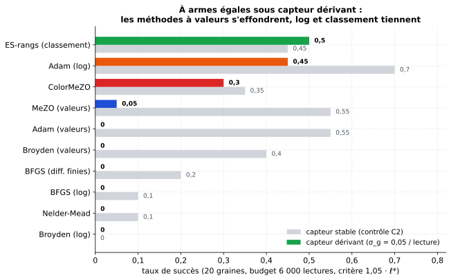

[Sommaire](../README.md#le-rapport) · [← Partie 3](3_reetalonnage.md) · [Partie 5 →](5_llm.md)

# Partie 4. À armes égales : toutes les méthodes lisent le même capteur

> **Ce qu'il faut retenir**
>
> - Sous gain dérivant, **toutes les méthodes qui comparent des valeurs s'effondrent** (0 à 5 % de succès) : MeZO, Adam,
>   Broyden, BFGS, Nelder-Mead.
> - Passer en lecture logarithmique sauve les méthodes à gradient stochastique (**Adam-log 0,45**, ColorMeZO 0,30) mais pas
>   les quasi-Newton (Broyden-log et BFGS-log à 0).
> - **L'ES par rangs reste la meilleure méthode robuste (0,50).** ColorMeZO ne bat pas le classement.

## 4.1 Le banc

Même tâche qu'en [partie 1](1_jouet.md), même capteur (σ_g = 0,05 par lecture, 12 bits), budget de 6 000 lectures, 20
graines ; chaque méthode lit le capteur, en valeurs reconstruites (« lin ») ou en logarithmes (« log »). Contrôle : les mêmes
méthodes à gain stable. `src/bench_etude4.py`.

## 4.2 Résultats

| Méthode | Dérive : succès | Ratio médian | Stable : succès | Lectures médianes (stable) |
|:---|:---:|:---:|:---:|:---:|
| MeZO (SPSA, lin) | 0,05 | 2,78 | 0,55 | 1 734 |
| ColorMeZO (SPSA, log) | **0,30** | 1,15 | 0,35 | 3 270 |
| Adam sur la pente SPSA lin | 0,00 | 3,21 | 0,55 | 4 396 |
| Adam sur la pente ColorMeZO (« Adam-log ») | **0,45** | 1,09 | **0,70** | 2 593 |
| Broyden, lin | 0,00 | 8,4 | 0,40 | 820 |
| Broyden, log | 0,00 | 11,0 | 0,00 | aucun succès |
| Nelder-Mead | 0,00 | 259 | 0,10 | 712 |
| BFGS (jacobienne FD explicite) | 0,00 | 196 | 0,20 | 339 |
| BFGS, log | 0,00 | 147 | 0,10 | 753 |
| ES par rangs | **0,50** | 1,06 | 0,45 | 2 088 |

- **Les méthodes à valeurs s'effondrent**, Nelder-Mead compris : son simplexe est construit sur des lectures faites à des
  gains différents.
- **La lecture log aide toutes les méthodes**, mais seules celles qui moyennent du bruit sur beaucoup de pas en profitent
  vraiment (Adam-log, ColorMeZO). Dans Broyden et BFGS, le bruit de gain s'accumule dans la jacobienne au lieu de s'annuler
  par paire.
- **Le classement gagne** : l'ES par rangs (0,50) devance Adam-log (0,45) et ColorMeZO (0,30).
- **Broyden-log ne bat pas ColorMeZO** (0 contre 0,30). La conclusion du projet couleur (« Broyden classique reste moins
  cher ») suppose un capteur stable ; elle ne survit pas au gain dérivant.
- **Le contrôle passe** : à gain stable, les classiques convergent (Broyden-lin 0,40 en 820 lectures, BFGS 0,20). Leurs
  échecs sous dérive viennent bien de la dérive.

Résultats bruts : [`results/bench_etude4.json`](../results/bench_etude4.json).

## 4.3 Bilan de la partie 4

**Ce qui marche.** La lecture logarithmique est la bonne lecture pour toute méthode à gradient stochastique sous gain
dérivant ; ColorMeZO en est la version SPSA.

**Les limites.**
- ColorMeZO seul n'est pas la meilleure méthode robuste du jouet : l'ES par rangs et Adam-log font mieux. Adam-log est
  ColorMeZO suivi d'Adam : la lecture couleur reste l'ingrédient qui le sauve (Adam sur la pente lin est à 0), mais Adam
  ajoute deux tampons de la taille des poids, ce que MeZO cherche précisément à éviter sur un LLM. L'ES par rangs, lui,
  demande 8 lectures par pas au lieu de 2. La partie 5 ne garde que la variante MeZO.
- Les quasi-Newton ont été réglés une fois (ε = 10⁻² pour les différences finies, calibré sur le contrôle stable).

---

[Sommaire](../README.md#le-rapport) · [← Partie 3](3_reetalonnage.md) · [Partie 5 →](5_llm.md)
