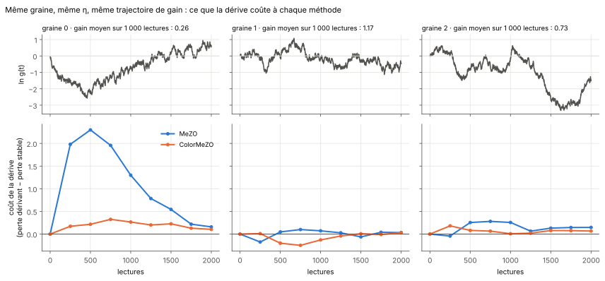
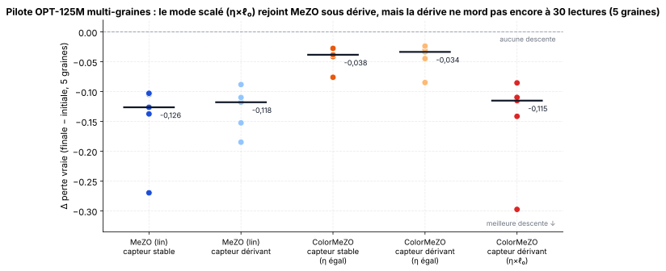
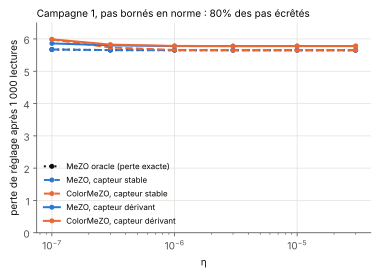
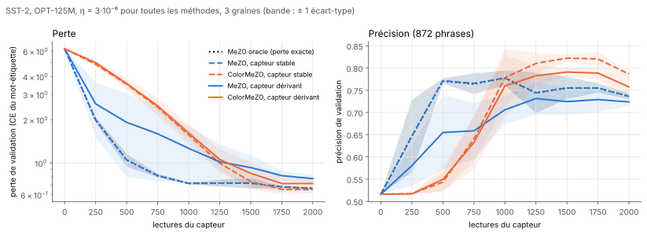
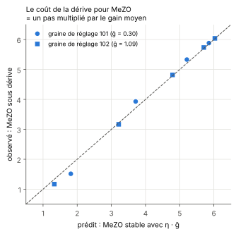
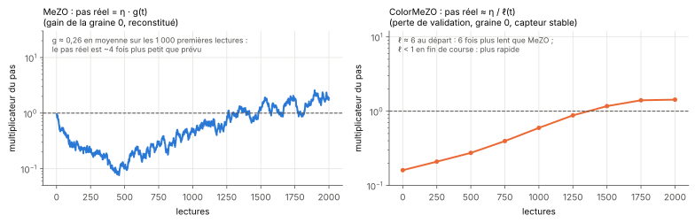
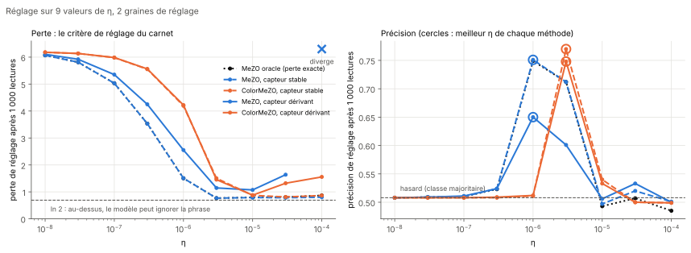
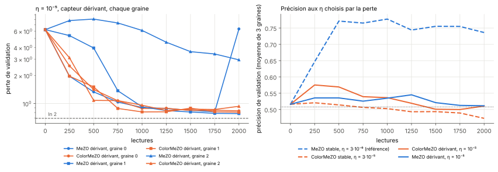
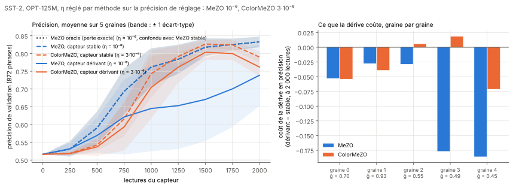

[Sommaire](../README.md#le-rapport) · [← Partie 4](4_armes_egales.md) · [Partie 6 →](6_phase.md)

# Partie 5. Sur un LLM réel : OPT-125M et SST-2

> **Ce qu'il faut retenir**
>
> - Le système complet (sonde SPSA sur 125 M de paramètres, capteur couleur quantifié et dérivant) **apprend SST-2** : la
>   précision passe de 0,516 à 0,83 en 2 000 lectures pour MeZO à son meilleur η. À gain stable, MeZO capteur égale
>   l'oracle à 3·10⁻³ près.
> - **La dérive coûte cher à MeZO et peu à ColorMeZO.** À η réglé par méthode (finale sur le jeu de test, 5 graines), elle
>   coûte à MeZO 9,4 points de précision et +0,52 de perte après 2 000 lectures, et à ColorMeZO 2,8 points et +0,06.
>   ColorMeZO est le moins pénalisé en perte sur 4 graines sur 5 à chaque budget. À η égal (campagne 2, 3 graines), l'écart
>   est du même ordre : +0,54 contre +0,05 de perte après 1 000 lectures.
> - **ColorMeZO n'atteint pas l'oracle.** Sous dérive, il finit à 0,762 de précision contre 0,833 pour l'oracle (0,739 pour
>   MeZO dérivant, dont 2 graines décrochent à 0,62 et 0,64). À gain stable, il a la perte la plus basse (0,646 contre 0,867)
>   mais une précision plus faible (0,790) : elle culmine vers 1 500 lectures puis recule.
> - **MeZO sous dérive diverge, ColorMeZO jamais** : à η = 10⁻⁴, MeZO dérivant produit des valeurs non finies sur les deux
>   graines de réglage, et à 10⁻⁵ il explose sur 2 graines finales sur 3 ; ColorMeZO reste fini à tous les η testés.
> - **Le critère de réglage prévu était mauvais** : la perte après 1 000 lectures favorise des η trop grands, qui
>   atteignent vite un plateau où le modèle ignore la phrase (précision 0,47 à 0,51 en finale). Les η de la finale sont
>   choisis sur la précision de réglage.

## 5.1 Le pilote : OPT-125M en NumPy pur

Premier essai (2026-10-26, 1 graine), sans PyTorch : le chargeur dé-sérialise `pytorch_model.bin` (archive zip + pickle) en Python
pur, le tokenizer GPT-2 BPE est réimplémenté, la passe avant OPT est écrite à la main (12 couches, positions apprises avec
décalage de 2). Vérification : « The president of the United States lives in the White » → « House » (logit 16,4 contre
11,4 pour le suivant).

Tâche : perte de langage d'une seule phrase, 15 pas × 2 lectures, ε = 10⁻³, η = 10⁻⁶ fixé a priori, 1 graine, ~175 s par
condition sur 2 cœurs CPU. Perte initiale 3,776.

| Variante | Perte finale | Δ |
|:---|:---:|:---:|
| MeZO, capteur stable | 3,506 | −0,27 |
| MeZO, capteur dérivant | 3,591 | −0,18 |
| ColorMeZO dérivant, η égal | 3,691 | −0,08 |
| ColorMeZO dérivant, η × ℓ₀ | **3,478** | **−0,30** |

Le système tourne de bout en bout ; la perturbation est appliquée en place et régénérée depuis la graine (aucune copie des
poids), et la restauration est fusionnée avec la mise à jour. À η égal, ColorMeZO descend moins vite, ce que la
[partie 0](0_introduction.md#les-méthodes) prévoit (pas réel η/ℓ) ; avec η multiplié par la perte initiale, il fait la
meilleure descente sur cette graine.

**Le même pilote sur 5 graines** (2026-11-04, 25 runs, ~165 s chacun, mêmes conditions exactes) :

| Condition | Δ perte médian | Étendue |
|:---|:---:|:---:|
| MeZO, capteur stable | **−0,126** | [−0,270 ; −0,103] |
| MeZO, capteur dérivant | −0,118 | [−0,185 ; −0,088] |
| ColorMeZO, capteur stable, η égal | −0,038 | [−0,076 ; −0,028] |
| ColorMeZO, capteur dérivant, η égal | −0,034 | [−0,085 ; −0,024] |
| ColorMeZO, capteur dérivant, η × ℓ₀ | −0,115 | [−0,297 ; −0,085] |

- **η × ℓ₀ est indispensable** : sous le même capteur dérivant, la version mise à l'échelle descend plus que ColorMeZO à η égal
  sur 5 graines sur 5 (écart médian 0,08). À η égal, ColorMeZO descend moins que MeZO sur 5 graines sur 5, à gain stable comme
  sous dérive.
- **L'avantage du pilote à 1 graine ne se reproduit pas** : ColorMeZO mis à l'échelle ne bat MeZO sous dérive que sur la
  graine 0, celle du pilote (−0,297 contre −0,185) ; sur les 4 autres, les deux sont à moins de 0,011.
- **À 30 lectures, la dérive ne mord pas encore** : `ln g` ne s'écarte que de ±0,05·√30 ≈ ±0,27, et MeZO stable ne bat MeZO
  dérivant que sur 3 graines sur 5. Il n'y a encore rien à encaisser pour ColorMeZO ; c'est ce qui a motivé la campagne à
  1 000 à 2 000 lectures ci-dessous, où la dérive cumulée atteint ±1,6 à ±2,2.

Code : [`pilot-llm/`](../pilot-llm/) (`opt_mezo_pilot.py`, `opt_mezo_seeds.py`) · résultats bruts :
[`results_seeds.json`](../pilot-llm/results_seeds.json).

## 5.2 Première campagne : un garde-fou qui efface tout

Le protocole complet (5.3) a d'abord tourné avec la borne de norme du jouet, `‖η·γ·z‖ ≤ 0,1`. Le gradient d'OPT-125M est
grand (norme ~180 à l'initialisation, estimée d'après les taux d'écrêtage) : au-delà de η ≈ 7·10⁻⁸, la majorité des pas
était écrêtée.

- **80 % des pas écrêtés au réglage, 94 à 99 % en campagne finale.** Chaque pas avait alors une norme fixe ; seul le signe
  de la pente comptait, et η n'avait plus d'effet (de 10⁻⁶ à 3·10⁻⁵, les pertes de réglage varient de moins de 0,01).
- Or MeZO et ColorMeZO ne diffèrent que par la **grandeur** de la pente. Écrêtées, les deux méthodes ont fait la même chose :
  perte finale 5,23 à gain stable pour toutes, 5,49 contre 5,49 sous dérive.
- **Aucune méthode n'a appris la tâche** : précision 0,516 partout, oracle compris. La perte baissait linéairement (6,23 →
  5,23) : le modèle apprenait la fréquence des deux mots-étiquettes, pas la polarité.

Cette campagne ne départage rien ; elle est conservée telle quelle
([`campagne1_ecretage.json`](../campagne-llm/results/campagne1_ecretage.json)). La campagne 2 retire la borne.

## 5.3 Le protocole de la campagne 2

- **Modèle et tâche** : OPT-125M en fp32 (sans TF32), tous les poids entraînés sauf les positions. SST-2 par prompt, comme
  MeZO : `<phrase> It was` → ` great` ou ` terrible`. Perte = entropie croisée sur tout le vocabulaire du mot-étiquette ;
  précision = choix entre les deux mots.
- **Données** : par graine, 1 000 phrases d'entraînement équilibrées tirées du train SST-2, minibatchs de 16. Réglage sur 500
  phrases du train, disjointes de tous les sous-ensembles d'entraînement. Mesure finale sur SST-2 validation (872 phrases),
  9 points de 0 à 2 000 lectures.
- **Sonde** : ε = 10⁻³, perturbation gaussienne régénérée depuis la graine, aucune borne de pas.
- **Capteur** : celui de l'[introduction](0_introduction.md#le-capteur), σ_g = 0,05 par lecture, 12 bits.
- **Méthodes** : oracle, MeZO et ColorMeZO, chacun à gain stable et dérivant (5 configurations).
- **Réglage** : η ∈ {10⁻⁸, 3·10⁻⁸, …, 3·10⁻⁶}, prolongée ensuite jusqu'à 10⁻⁴ (5.7), 2 graines de réglage (101, 102),
  1 000 lectures, critère = perte moyenne sur le jeu de réglage. Campagne finale : 3 graines (0, 1, 2), 2 000 lectures.
  La finale à η réglé sur la précision (5.8) reprend le même protocole avec 5 graines (0 à 4).
- **Appariement** : pour une graine, toutes les méthodes voient les mêmes directions, les mêmes minibatchs et la même
  trajectoire de gain. Le coût de la dérive se mesure donc graine par graine, à η égal.
- Calcul mesuré : 49 s par run de réglage, 116 s par run final, ~1 h 20 au total sur GPU.

## 5.4 Le système apprend SST-2

Moyenne ± écart-type sur 3 graines. Avant entraînement : perte 6,225, précision 0,516. η = 3·10⁻⁶ pour toutes les méthodes.

| Méthode | Perte @500 | Perte @1000 | Perte @2000 | Précision @1000 | Précision @2000 |
|:---|:---:|:---:|:---:|:---:|:---:|
| MeZO oracle (perte exacte) | 1,048 ± 0,106 | **0,720** ± 0,008 | 0,664 ± 0,010 | 0,778 | 0,736 |
| MeZO, capteur stable | 1,049 ± 0,106 | **0,720** ± 0,008 | 0,664 ± 0,010 | 0,778 | 0,736 |
| ColorMeZO, capteur stable | 3,533 ± 0,135 | 1,566 ± 0,091 | **0,651** ± 0,036 | 0,778 | **0,786** |
| MeZO, capteur dérivant | 1,916 ± 1,121 | 1,263 ± 0,548 | 0,777 ± 0,050 | 0,706 | 0,724 |
| ColorMeZO, capteur dérivant | 3,565 ± 0,307 | 1,614 ± 0,253 | 0,718 ± 0,062 | 0,760 | 0,757 |

- **MeZO capteur stable = oracle**, à 10⁻³ près à chaque point : sur un LLM aussi, la quantification sur 12 bits ne coûte
  rien quand le gain est stable.
- **ColorMeZO démarre lentement puis rattrape** : 3,5 de perte à 500 lectures contre 1,0 pour MeZO, puis 0,651 contre 0,664
  à 2 000 (mieux sur 2 graines sur 3). C'est le pas réel η/ℓ : 6 fois plus petit que celui de MeZO tant que ℓ ≈ 6, plus
  grand dès que ℓ passe sous 1.
- **Précision** : MeZO culmine vers 0,78 à 1 000 lectures puis redescend à 0,74 alors que sa perte baisse encore ;
  ColorMeZO, plus tardif, est à 0,786 à 2 000 lectures (mieux que MeZO stable sur 3 graines sur 3). Avec 16 passages sur
  chaque phrase d'entraînement, un début de sur-apprentissage est possible ; il n'a pas été vérifié.
- **La dérive se voit surtout sur MeZO** : sa bande inter-graines s'élargit (± 1,1 à 500 lectures contre ± 0,1 à gain stable).

## 5.5 Le coût de la dérive, graine par graine

La figure en tête de partie montre, pour chaque graine, la trajectoire du gain (reconstituée exactement depuis la graine du
capteur) et l'écart de perte entre la version dérivante et la version stable de chaque méthode, à η égal.

| Lectures | MeZO : coût par graine (0, 1, 2) | Moyenne | ColorMeZO : coût par graine | Moyenne | ColorMeZO moins pénalisé |
|:---|:---:|:---:|:---:|:---:|:---:|
| 500 | +2,30 · +0,05 · +0,26 | **+0,87** | +0,22 · −0,20 · +0,08 | **+0,03** | 3/3 |
| 1 000 | +1,30 · +0,07 · +0,26 | **+0,54** | +0,27 · −0,13 · +0,01 | **+0,05** | 3/3 |
| 2 000 | +0,16 · +0,03 · +0,15 | **+0,11** | +0,11 · +0,03 · +0,07 | **+0,07** | 3/3 |

- **La graine 0 fait l'essentiel de l'écart moyen** : son gain descend jusqu'à e^−2,6 ≈ 0,08 vers 450 lectures (moyenne 0,26 sur
  1 000 lectures). MeZO y perd jusqu'à 2,3 de perte ; ColorMeZO, sur exactement les mêmes lectures, 0,33 au plus.
- **La graine 1, au gain proche de 1** (moyenne 1,17), ne coûte presque rien aux deux méthodes : la dérive ne nuit à MeZO
  que dans la mesure où elle éloigne le gain de 1.
- **À 2 000 lectures l'écart se resserre** (0,11 contre 0,07) : MeZO rattrape une fois que le gain remonte (graine 0) ou
  que la perte atteint son plateau. Le coût de la dérive est donc surtout un **retard**.

Les runs de réglage donnent une seconde mesure, indépendante : à chacun des 6 η et pour chacune des 2 graines de réglage,
MeZO et ColorMeZO ont tourné à gain stable et dérivant.

| Sur 12 couples (η, graine de réglage) | MeZO | ColorMeZO |
|:---|:---:|:---:|
| \|perte dérivant − perte stable\|, médiane | 0,20 | **0,005** |
| idem, maximum | 2,30 | **0,13** |
| couples où la méthode est la moins touchée | 1 | **11** |

## 5.6 Pourquoi : deux pas réels différents

- **MeZO.** Sa pente vaut `≈ g(t) · ∂ℓ` : sous dérive, il avance comme MeZO stable dont le pas serait η·g(t). Test direct sur
  les runs de réglage : pour chaque η, la perte de MeZO dérivant est comparée à celle de MeZO stable au pas η·ḡ, où ḡ est le
  gain moyen sur les 1 000 lectures (interpolé sur la grille). Sur les 9 points comparables, l'écart médian est de **0,05**
  (maximum 0,30). Avec ḡ = 0,30 (graine 101), la dérive revient à diviser η par 3 ; avec ḡ = 1,09 (graine 102), elle ne
  change presque rien, et peut même aider : sous 3·10⁻⁶, un pas un peu plus grand fait gagner.
- **ColorMeZO.** Sa pente vaut `∂ℓ/ℓ` : le gain en est absent, il ne reste que le bruit de dérive entre les deux lectures
  d'une paire (écart-type σ_g sur `δ ln ℓ`, puisqu'un seul tirage de dérive sépare les deux lectures). Ce bruit est sans
  biais et se moyenne sur les pas. D'où un coût de la dérive dix à quarante fois plus faible.
- **Le prix de ColorMeZO** est le facteur 1/ℓ : sur la grille de réglage, ColorMeZO à η se comporte comme MeZO à η/3
  (à η = 3·10⁻⁶ : 1,69 et 1,32 contre 1,63 et 1,38 pour MeZO à 10⁻⁶) à η/6 (aux petits η, où la perte reste proche de 6).
  C'est la même chose que le facteur ~2 en lectures du jouet ([partie 1](1_jouet.md)), et ce qu'un η plus grand doit
  compenser : la grille étendue (5.7) le confirme.

## 5.7 La grille étendue : le classement à η réglé

Dans la campagne 2, η* = 3·10⁻⁶ était au bord haut de la grille pour les cinq méthodes. La grille a été prolongée à 10⁻⁵,
3·10⁻⁵ et 10⁻⁴ (30 runs de réglage de plus), puis les finales ont été relancées pour les méthodes dont η* changeait.

**Ce que le critère de perte a choisi.**

| Méthode | η* (perte) | Perte de réglage | η* (précision) | Précision de réglage |
|:---|:---:|:---:|:---:|:---:|
| MeZO oracle | 3·10⁻⁶ | 0,769 | 10⁻⁶ | **0,749** |
| MeZO, capteur stable | 3·10⁻⁶ | 0,769 | 10⁻⁶ | **0,751** |
| ColorMeZO, capteur stable | 3·10⁻⁵ | 0,812 | 3·10⁻⁶ | **0,770** |
| MeZO, capteur dérivant | 10⁻⁵ | 1,074 | 10⁻⁶ | 0,650 |
| ColorMeZO, capteur dérivant | 10⁻⁵ | 0,878 | 3·10⁻⁶ | **0,748** |

Précision de réglage : 500 phrases du train jamais vues à l'entraînement, après 1 000 lectures, moyenne des graines 101 et
102.

- **Au-delà de 3·10⁻⁶, la perte cesse de baisser et la précision retombe au hasard** (0,48 à 0,54), pour toutes les
  méthodes. La perte de réglage reste entre 0,78 et 0,87 à gain stable, plus haut sous dérive. Le modèle a appris à répondre « great » ou « terrible », pas lequel. Mettre la même masse sur les deux mots
  coûte ln 2 ≈ 0,69 : une perte vers 0,8 est donc compatible avec une réponse qui ignore la phrase, et seule la précision
  distingue ce cas d'un vrai apprentissage (MeZO sous dérive à 3·10⁻⁶ finit aussi vers 0,78, mais à 0,72 de précision).
- **Le critère « perte après 1 000 lectures » tombe dans ce piège** : il préfère un η qui atteint vite le plateau à un η qui
  le traverse plus lentement. Il retient 3·10⁻⁵ pour ColorMeZO stable et 10⁻⁵ pour les deux méthodes sous dérive.
- **Choisi sur la précision, η* est intérieur à la grille pour toutes les méthodes** : 10⁻⁶ pour MeZO (oracle, stable,
  dérivant), 3·10⁻⁶ pour ColorMeZO (stable, dérivant). Le rapport 3 est celui que prévoit le pas réel η/ℓ.
- **Sur le jeu de réglage, à ce η, ColorMeZO sous dérive égale l'oracle** (0,748 contre 0,749) ; MeZO sous dérive est
  10 points dessous (0,650). La dérive coûte 2,2 points à ColorMeZO (0,770 → 0,748) et 10,1 points à MeZO (0,751 → 0,650).
  L'écart de MeZO vient de la graine 101, au gain moyen de 0,30 : 0,52 contre 0,78 sur la graine 102. Sur le jeu de test,
  la finale à 5 graines (5.8) ne confirme que la seconde moitié de ce constat.

**Les finales aux η choisis par la perte.**

Sur SST-2 validation, 3 graines, 2 000 lectures :

| Méthode | η | Perte @2000 par graine (0, 1, 2) | Précision @2000 |
|:---|:---:|:---:|:---:|
| ColorMeZO, capteur stable | 3·10⁻⁵ | 0,78 · 0,78 · 0,80 | 0,473 |
| MeZO, capteur dérivant | 10⁻⁵ | **6,33** · 0,78 · **2,95** | 0,511 |
| ColorMeZO, capteur dérivant | 10⁻⁵ | 0,84 · 0,81 · 0,93 | 0,511 |
| *rappel : MeZO stable* | *3·10⁻⁶* | *0,67 · 0,68 · 0,65* | *0,736* |

- **Aucune méthode n'apprend la polarité à ces η** : précision de 0,47 à 0,51. Ces finales ne départagent donc rien en
  précision ; elles servent à mesurer la stabilité.
- **MeZO sous dérive explose quand le gain monte.** Graine 2 : `ln g` atteint +0,62 dans les 500 premières lectures, la
  perte monte à 8,1 avant de redescendre. Graine 0 : la perte est à 0,82 à 1 750 lectures, puis `ln g` remonte à +0,94
  (gain ≈ 2,6) et la perte saute à 6,33. ColorMeZO, sur les mêmes lectures, reste entre 0,81 et 0,93.
- **À η = 10⁻⁴, MeZO dérivant diverge** (pas non finis sur les deux graines de réglage, perte inf), alors que MeZO stable
  reste fini (0,80) : c'est le gain, pas le pas, qui fait diverger. ColorMeZO reste fini à tous les η, dérive ou non.

## 5.8 La finale à η réglé : 5 graines sur le jeu de test

Les η sont ceux que la précision de réglage a choisis en 5.7 : 10⁻⁶ pour l'oracle et MeZO, 3·10⁻⁶ pour ColorMeZO. Graines de
test 0 à 4 (0 à 2 sont celles des campagnes précédentes), 2 000 lectures, SST-2 validation. 25 runs de 124 s, 52 min sur GPU.
Contrôle de reproductibilité : ColorMeZO à 3·10⁻⁶ sur les graines 0 à 2 redonne la perte finale de la campagne 2 à 10⁻⁴ près.

Moyenne ± écart-type sur 5 graines. Avant entraînement : perte 6,225, précision 0,516.

| Méthode | η | Perte @1000 | Perte @2000 | Précision @1000 | Précision @2000 | Meilleure précision* |
|:---|:---:|:---:|:---:|:---:|:---:|:---:|
| MeZO oracle | 10⁻⁶ | 1,556 ± 0,078 | 0,867 ± 0,052 | 0,762 | **0,833** ± 0,015 | 0,835 |
| MeZO, capteur stable | 10⁻⁶ | 1,556 ± 0,078 | 0,867 ± 0,052 | 0,762 | **0,833** ± 0,015 | 0,836 |
| ColorMeZO, capteur stable | 3·10⁻⁶ | 1,618 ± 0,105 | **0,646** ± 0,030 | 0,743 | 0,790 ± 0,016 | 0,837 |
| MeZO, capteur dérivant | 10⁻⁶ | 2,643 ± 1,100 | 1,390 ± 0,309 | 0,645 | 0,739 ± 0,086 | 0,740 |
| ColorMeZO, capteur dérivant | 3·10⁻⁶ | 1,649 ± 0,202 | 0,710 ± 0,051 | 0,705 | 0,762 ± 0,025 | 0,814 |

\* Maximum sur les 9 points de mesure de chaque course, moyenné sur les graines. Il est lu sur le jeu de test lui-même :
c'est une borne optimiste, pas un résultat d'arrêt anticipé.

- **Le contrôle C1 tient** : MeZO capteur stable égale l'oracle à chaque point (écart de précision ≤ 3·10⁻³).
- **À gain stable, l'oracle finit devant ColorMeZO en précision** (0,833 contre 0,790), alors que ColorMeZO a la perte la
  plus basse (0,646 contre 0,867). Sa précision culmine à 0,827 vers 1 500 lectures, au-dessus de l'oracle à ce point
  (0,818), puis recule ; celle de l'oracle monte jusqu'au bout. La perte de ColorMeZO remonte en fin de course sur 4 runs
  sur 10 (graine 2 à gain stable, graines 1, 2 et 4 sous dérive), jamais celle de MeZO. Lecture probable, non vérifiée :
  son pas réel η/ℓ grandit d'un facteur 10 quand la perte passe de 6,2 à 0,65, et finit trop grand.
- **Sous dérive, ColorMeZO est le plus régulier** : 0,734 à 0,795 de précision finale selon la graine. MeZO dérivant reste
  près de son niveau stable sur 3 graines (0,788 à 0,819) et décroche sur les graines 3 et 4 (0,644 et 0,624, 18 points
  sous son contrôle stable). Son écart-type inter-graines est 3,4 fois celui de ColorMeZO (0,086 contre 0,025).
- **Le gain dérive vers le bas sur les 5 graines** (gain moyen sur la course : 0,70 ; 0,93 ; 0,55 ; 0,49 ; 0,45). Les deux
  graines où MeZO décroche sont celles au gain moyen le plus bas, mais la graine 2 (0,55) ne lui coûte que 3 points : le
  gain moyen n'explique pas tout.

**Le coût de la dérive, graine par graine** (même graine, même η, même trajectoire de gain ; dérivant moins stable) :

| Lectures | Mesure | MeZO, par graine (0 à 4) | Moyenne | ColorMeZO, par graine | Moyenne | ColorMeZO moins pénalisé |
|:---|:---|:---:|:---:|:---:|:---:|:---:|
| 500 | perte | +2,14 · +0,01 · +0,53 · +1,55 · −0,45 | **+0,76** | +0,22 · −0,20 · +0,08 · −0,03 · −0,14 | **−0,02** | 4/5 |
| 1 000 | perte | +2,54 · −0,20 · +0,75 · +2,20 · +0,15 | **+1,09** | +0,27 · −0,13 · +0,01 · +0,11 · −0,10 | **+0,03** | 4/5 |
| 2 000 | perte | +0,32 · +0,02 · +0,59 · +0,91 · +0,77 | **+0,52** | +0,11 · +0,03 · +0,07 · +0,03 · +0,10 | **+0,06** | 4/5 |
| 1 000 | précision | −0,194 · −0,011 · −0,061 · −0,200 · −0,118 | **−0,117** | −0,025 · −0,011 · −0,019 · −0,107 · −0,030 | **−0,039** | 4/5 (1 égalité) |
| 2 000 | précision | −0,053 · −0,028 · −0,029 · −0,177 · −0,186 | **−0,094** | −0,054 · −0,039 · +0,006 · +0,018 · −0,071 | **−0,028** | 3/5 |

- En perte, la dérive coûte à ColorMeZO 8 fois moins qu'à MeZO après 2 000 lectures et 35 fois moins après 1 000 ; en
  précision, 3 fois moins.
- **Le critère de réfutation pré-enregistré est passé** : ColorMeZO dérivant a une perte de validation plus basse que MeZO
  dérivant sur 4 graines sur 5 à 1 000 lectures et 5 sur 5 à 2 000 (le seuil était 2 graines sur 3 aux deux budgets). En
  précision, il le bat sur 5 graines sur 5 à 1 000 lectures, mais sur 2 sur 5 seulement à 2 000.
- Aucune valeur non finie, aucune divergence à ces η.

**Ce que la finale corrige.** Sur le jeu de réglage, ColorMeZO sous dérive égalait l'oracle (0,748 contre 0,749). Sur le
jeu de test, il reste 7 points sous l'oracle à 2 000 lectures (0,762 contre 0,833) et 6 points à 1 000 (0,705 contre 0,762).
Ce qui se confirme est la robustesse : la dérive lui coûte 3 fois moins de précision qu'à MeZO, et l'écart entre graines
est 3,4 fois plus petit.

Résultats bruts : [`campagne4_finale_5graines.json`](../campagne-llm/results/campagne4_finale_5graines.json).

## 5.9 Limites

- **5 graines** au test, 2 au réglage, sur un seul jeu de validation de 872 phrases. Les écarts de précision entre
  méthodes stables (0,833 contre 0,790) sont de l'ordre de 3 écarts-types inter-graines.
- **Une tâche, un modèle, un σ_g.** 2 000 lectures, c'est 1 000 pas, soit environ 1 % du budget de MeZO sur SST-2 dans
  l'article d'origine : les précisions (0,74 à 0,83) sont loin de celles d'un MeZO entraîné jusqu'au bout.
- **Le critère de réglage** (perte à 1 000 lectures) a été fixé avant la campagne ; il s'est révélé inadapté au-delà de
  3·10⁻⁶. Les η de la finale viennent de la précision de réglage, choisie après coup sur les mêmes runs.
- **Pas d'arrêt anticipé** : la précision de ColorMeZO recule en fin de course, et un arrêt réglé sur le jeu de réglage
  n'a pas été mesuré.

## 5.10 Bilan de la partie 5

**Ce qui marche.** Sur un vrai LLM et une vraie tâche, la lecture couleur rend MeZO beaucoup moins sensible à un gain
dérivant. À η réglé, la dérive coûte à ColorMeZO 3 fois moins de précision et 8 fois moins de perte qu'à MeZO après 2 000
lectures, et ColorMeZO ne décroche sur aucune graine. MeZO sous dérive diverge aux grands η, ColorMeZO jamais. Le mécanisme
se mesure : MeZO avance de η·g, ColorMeZO de η/ℓ.

**Les limites.** ColorMeZO ne rejoint pas l'oracle : sous dérive il finit 7 points dessous en précision, et à gain stable
il descend plus bas en perte sans mieux classer. Il demande un η 3 fois plus grand, que rien ne règle automatiquement, et
son pas réel grandit quand la perte baisse.

Carnet : [`campagne-llm/colormezo_llm_sst2.ipynb`](../campagne-llm/colormezo_llm_sst2.ipynb) · résultats bruts :
[`campagne2.json`](../campagne-llm/results/campagne2.json),
[`campagne3_grille_etendue.json`](../campagne-llm/results/campagne3_grille_etendue.json) (la campagne 2 et les η ajoutés),
[`campagne4_finale_5graines.json`](../campagne-llm/results/campagne4_finale_5graines.json) · figures :
`python3 src/figures_rapport.py`.

---

[Sommaire](../README.md#le-rapport) · [← Partie 4](4_armes_egales.md) · [Partie 6 →](6_phase.md)
