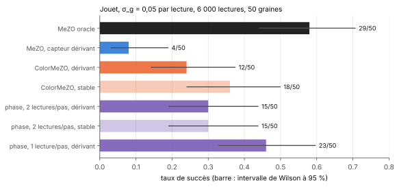

[Sommaire](../README.md#le-rapport) · [← Partie 5](5_llm.md) · [Partie 7 →](7_synthese.md)

# Partie 6. La phase : lire la pente dans la teinte



> **Ce qu'il faut retenir**
>
> - ColorMeZO ne lit que la luminosité `log|ℓ|`. Pour une perte réelle et positive, la teinte est constante et ne porte
>   rien. Une évaluation en `θ + iεz` lui donne un contenu : sa phase vaut `≈ ε·∂_zℓ/ℓ`, la pente relative de ColorMeZO,
>   et un gain réel positif n'y entre pas du tout.
> - **La phase est exactement insensible à la dérive du gain** : mêmes succès et même ratio médian à gain stable et
>   dérivant.
> - **À coût numérique égal, elle n'apporte rien** : 15 succès sur 50 contre 12 pour ColorMeZO sous dérive (p = 0,65).
>   Sur un ordinateur, une évaluation complexe coûte au moins une paire de passes réelles.
> - **Si le capteur mesure la phase en une seule lecture**, le budget donne deux fois plus de pas : 23 succès sur 50,
>   contre 12 pour ColorMeZO (p = 0,035) et 29 pour l'oracle (p = 0,32). Ce scénario suppose un capteur physique qui
>   n'a pas été identifié.
> - **L'estimateur n'est pas nouveau** : l'ordre zéro par pas complexe est publié (Jongeneel, Yue et Kuhn). Ce qui reste
>   propre ici est la lecture de l'argument, qui supprime le gain, et sa mesure sous dérive.

## 6.1 L'idée

La perte du jouet se prolonge aux paramètres complexes (tanh, produits et moyennes sont analytiques). En `θ + iεz` :

```
L = ℓ + i·ε·∂_zℓ − (ε²/2)·∂²_zℓ + …      donc      arg L ≈ ε · ∂_zℓ / ℓ
```

Un capteur qui rend `g·L`, avec `g` réel positif inconnu, rend la même phase : `arg(g·L) = arg L`. La pente se lit donc
sur **une seule évaluation**, sans paire, et le gain disparaît même s'il change à chaque lecture. Dans ColorMeZO, il reste
le bruit de dérive entre les deux lectures d'une paire (partie 2.1) ; ici, il n'y a plus de paire.

La mise à jour est celle de ColorMeZO : `θ ← θ − η · (arg L / ε) · z`, avec la même borne de pas que le jouet.

## 6.2 Ce que coûte une lecture complexe

- **Sur un ordinateur**, un nombre complexe est un couple de réels. Le produit `(a + ib)(c + id) = (ac − bd) + i(ad + bc)`
  coûte 4 multiplications réelles. La première couche reçoit une entrée réelle et coûte 2 produits matrice-vecteur, comme
  une paire ; les suivantes, dont les activations sont complexes, en coûtent 3 ou 4. Une passe complexe vaut donc 2 à 4
  passes réelles, et le banc la compte pour **2 lectures**, le cas le plus favorable. Sur GPU, la différentiation en mode
  direct (`jvp`) donne d'ailleurs la dérivée directionnelle exacte pour un coût comparable.
- **Sur un capteur physique** qui mesure amplitude et phase en une fois (une mesure interférométrique, par exemple), une
  évaluation est **1 lecture**. C'est le seul cas où la phase peut économiser du budget.

Le banc mesure les deux comptabilités, au même budget de 6 000 lectures.

## 6.3 Le banc

Même tâche, mêmes graines et même capteur qu'en [partie 1](1_jouet.md) (σ_g = 0,05 par lecture), phase quantifiée sur
12 bits dans [−π, π) (pas de 1,5·10⁻³ rad), ε = 10⁻². η réglé dans {10⁻⁴, 3·10⁻⁴, …, 0,3} sur les 5 graines de réglage,
puis **50 graines de test**. Les méthodes de référence sont re-réglées sur la même grille. `src/bench_phase.py`, 3 min 20
sur CPU.

| Méthode | η* | Succès | Ratio médian ℓ/ℓ* | Lectures médianes (succès) |
|:---|:---:|:---:|:---:|:---:|
| MeZO oracle | 0,1 | **29/50** | 1,01 | 1 734 |
| MeZO, capteur dérivant | 0,01 | 4/50 | 1,96 | 2 451 |
| ColorMeZO, capteur stable | 0,003 | 18/50 | 1,15 | 3 398 |
| ColorMeZO, capteur dérivant | 0,003 | 12/50 | 1,22 | 1 905 |
| Phase, 2 lectures par pas, capteur stable | 0,003 | 15/50 | 1,22 | 2 374 |
| Phase, 2 lectures par pas, capteur dérivant | 0,003 | 15/50 | 1,22 | 2 374 |
| **Phase, 1 lecture par pas, capteur dérivant** | 0,001 | **23/50** | 1,07 | 2 617 |

Test exact de Fisher sur les taux de succès :

| Comparaison | Succès | p |
|:---|:---:|:---:|
| phase à 2 lectures contre ColorMeZO, sous dérive | 15 contre 12 | 0,65 |
| phase à 1 lecture contre ColorMeZO, sous dérive | 23 contre 12 | **0,035** |
| phase à 1 lecture contre l'oracle | 23 contre 29 | 0,32 |
| ColorMeZO contre MeZO, sous dérive | 12 contre 4 | 0,054 |

- **L'invariance est exacte** : à 2 lectures par pas, la phase donne les mêmes 15 succès et le même ratio médian à gain
  stable et sous dérive. ColorMeZO, lui, perd 6 succès sous dérive (18 → 12).
- **À coût égal, la phase ne bat pas ColorMeZO** de façon mesurable. Supprimer le bruit de dérive intra-paire ne suffit
  pas : il reste le bruit de la direction aléatoire `z` et la quantification de la phase.
- **À une lecture par pas, la phase approche l'oracle.** Le gain vient du nombre de pas (6 000 au lieu de 3 000), pas d'une
  meilleure information par pas. Son η* est plus petit (10⁻³) : plus de pas permet des pas plus courts.
- Au run 1 (20 graines, grille de la partie 1, 6.4), les références redonnent exactement les résultats de la partie 1
  (11, 1, 6 et 7 succès sur 20).

## 6.4 Le premier run : ε, bruit de phase et grille

Un premier run exploratoire (20 graines, grille de la partie 1, `python3 src/bench_phase.py --run1`) a fixé les choix
du banc ci-dessus.

| Variante (sous dérive) | ε = 10⁻², 2 lectures | ε = 10⁻², 1 lecture | ε = 0,1, 2 lectures | ε = 0,1, 1 lecture |
|:---|:---:|:---:|:---:|:---:|
| sans bruit de phase | 8/20 | 10/20 | 0/20 | 0/20 |
| bruit de phase σ_ψ = 10⁻³ par lecture | 6/20 | 10/20 | 0/20 | 0/20 |
| bruit de phase σ_ψ = 10⁻² par lecture | 5/20 | 10/20 | 0/20 | 0/20 |

- **ε = 0,1 échoue partout** (ratio médian 1,9 à 2,6). La prédiction écrite avant le run attendait l'inverse (un biais en
  ε² encore faible) ; la cause n'a pas été diagnostiquée.
- **Un bruit de phase indépendant d'une lecture à l'autre se moyenne** : même à σ_ψ = 10⁻² (autant que ε), la phase garde
  5/20 à 2 lectures et 10/20 à 1 lecture. La prédiction d'une destruction dès que σ_ψ approche ε·pente est réfutée pour ce
  bruit. Un décalage de phase qui dérive lentement, comme le gain, n'a pas été testé : son amplitude croîtrait avec le
  temps (≈ 0,05 rad en fin de course pour σ_ψ = 10⁻³).
- **Le η* était au bord bas de la grille** (0,003) pour la phase et pour ColorMeZO, d'où la grille étendue du banc 6.3.
  L'écart de 8 contre 6 sur 20 graines ne s'est pas maintenu sur 50 (15 contre 12).

Résultats bruts : [`bench_phase.json`](../results/bench_phase.json) (run 1),
[`bench_phase_50graines.json`](../results/bench_phase_50graines.json) (banc 6.3).

## 6.5 Ce qui existe déjà

Une recherche ciblée (sept requêtes, trois textes lus au niveau du résumé et de la page d'arXiv) donne trois points de
repère.

- **L'ordre zéro par pas complexe est publié.** Jongeneel, Yue et Kuhn ([arXiv:2103.05478](https://arxiv.org/abs/2103.05478))
  estiment le gradient à partir d'une seule évaluation en un point de partie imaginaire `δ·z`, pour une fonction analytique
  réelle. L'estimateur évite l'annulation numérique des différences finies, sa variance reste bornée quand δ → 0, et il
  atteint les taux de convergence des méthodes à plusieurs points. Il utilise la partie imaginaire `Im f / δ`, qui garde
  l'échelle de `f`. La variante de cette partie divise par la partie réelle (l'argument), ce qui supprime un gain réel
  positif : c'est une petite modification, pas une nouvelle méthode. L'article ne traite pas de capteur à gain inconnu.
- **L'entraînement sur puce de réseaux optiques par ordre zéro existe.** Gu et al. (AAAI 2021,
  [arXiv:2012.11148](https://arxiv.org/abs/2012.11148)) optimisent les phases des interféromètres de Mach-Zehnder par
  ordre zéro creux ; ils rapportent que leur méthode antérieure, FLOPS, demande 60 requêtes par itération et diverge dans
  plusieurs configurations denses. Leur modèle de bruit porte sur les déphaseurs et le couplage thermique ; « power-aware »
  y désigne la consommation électrique, pas une fluctuation de la puissance optique.
- **L'optique adaptative utilise déjà une paire symétrique.** Le SPGD (par exemple
  [arXiv:1105.0976](https://arxiv.org/abs/1105.0976), coronographe à haut contraste) perturbe toutes les commandes à la
  fois et lit `J₊ − J₋` sur une caméra, exactement le schéma de MeZO. Cet article ne traite pas les fluctuations
  d'intensité ; il note la limite de dynamique d'une caméra 8 bits, l'équivalent de la quantification du capteur ici.

Ce qui n'a pas été trouvé : un travail qui fasse du **gain multiplicatif inconnu et dérivant** le problème central d'une
méthode d'ordre zéro, ou qui utilise la phase pour s'en affranchir. Les requêtes sur le bruit multiplicatif, l'extremum
seeking sous dérive et la surveillance de puissance en photonique n'ont renvoyé que des titres non lus. L'absence n'est
pas établie : l'extremum seeking et la photonique intégrée, où des moniteurs de puissance sur puce peuvent servir de voie
de référence, sont les endroits à examiner.

## 6.6 Bilan de la partie 6

**Ce qui marche.** La phase d'une évaluation complexe porte la pente relative de ColorMeZO et ignore exactement un gain
réel positif, même s'il change à chaque lecture. Si un capteur la mesure en une lecture, elle double le nombre de pas et
approche l'oracle sous dérive sur le jouet (23/50 contre 29/50).

**Les limites.**
- Sur un ordinateur, elle n'apporte rien : à coût égal, elle fait jeu égal avec ColorMeZO, et `jvp` fait mieux.
- Le scénario favorable suppose un capteur physique à lecture complexe et à gain dérivant, qui n'a pas été identifié.
- L'estimateur par pas complexe existe déjà ; la nouveauté se réduit à la lecture de l'argument.
- Une tâche jouet à 12 paramètres, un seul ε utile (10⁻²), pas de dérive lente de la phase, et un échec à ε = 0,1 non
  expliqué.

---

[Sommaire](../README.md#le-rapport) · [← Partie 5](5_llm.md) · [Partie 7 →](7_synthese.md)
