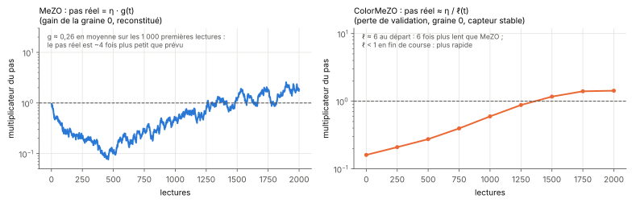

[Sommaire](../README.md#le-rapport) · [← Partie 6](6_phase.md) · [Fausses pistes →](fausses_pistes.md)

# Partie 7. Synthèse

> **Ce qu'il faut retenir**
>
> - Un seul fait explique l'essentiel du rapport : **MeZO avance de η·g, ColorMeZO de η/ℓ.** Quand le gain dérive, le pas
>   de MeZO dérive avec lui ; celui de ColorMeZO ne le voit pas, mais il est petit tant que la perte est grande et grandit
>   quand elle baisse.
> - Ce fait se mesure aux deux échelles : 1/20 contre 6/20 succès sur le jouet ; sur OPT-125M à η réglé, la dérive coûte
>   9,4 points de précision à MeZO contre 2,8 à ColorMeZO, et +0,52 de perte contre +0,06.
> - La robustesse ne fait pas l'optimum : sous dérive, ColorMeZO reste sous l'oracle (6/20 contre 11/20 sur le jouet, 0,762
>   contre 0,833 de précision sur le LLM).
> - Il a deux conséquences pratiques : ColorMeZO demande un η plus grand (3 fois sur le LLM), et il ne diverge pas quand le
>   gain monte, là où MeZO diverge.
> - La phase d'une évaluation complexe porte la même pente sans paire et ignore exactement le gain. Elle n'aide qu'avec un
>   capteur physique qui la mesure en une lecture.

## 7.1 Du jouet au LLM

| | Jouet (parties 1 à 4) | OPT-125M, SST-2 (partie 5) |
|---|---|---|
| Paramètres | 12 | 125 M |
| Graines de test | 20 à 50 | 3 (η égal), 5 (η réglé) |
| Budget | 6 000 lectures | 2 000 lectures |
| Mesure | succès (ℓ ≤ 1,05 ℓ*) | perte et précision de validation |
| MeZO capteur stable contre oracle | 11/20 contre 11/20 | 0,833 contre 0,833 de précision |
| **Sous dérive, MeZO** | 1/20 (stable : 11/20) | coût −0,094 de précision, +0,52 de perte @2000 |
| **Sous dérive, ColorMeZO** | 6/20 (stable : 7/20) | coût −0,028 de précision, +0,06 de perte @2000 |
| ColorMeZO stable contre MeZO stable, à η égal | | démarre 6 fois plus lentement, finit à 0,651 contre 0,664 de perte |
| ColorMeZO stable contre MeZO stable, à η réglé | 7/20 contre 11/20, 2 fois plus de lectures | 0,790 contre 0,833 de précision, 0,646 contre 0,867 de perte |
| **Sous dérive, à η réglé** | MeZO 1/20, ColorMeZO 6/20 | MeZO 0,739 ± 0,086, ColorMeZO 0,762 ± 0,025 de précision |
| η réglé | MeZO 0,1 (stable) ou 0,01 (dérive), ColorMeZO 0,003 | MeZO 10⁻⁶, ColorMeZO 3·10⁻⁶ (sur la précision) |
| Divergence sous dérive | | MeZO à 10⁻⁵ (2 graines sur 3) et 10⁻⁴ ; ColorMeZO jamais |

La direction est la même aux deux échelles ; l'effet est moins brutal sur le LLM. Deux raisons mesurables : la perte d'un
LLM ne varie que d'un facteur 10 sur la course (6,2 → 0,65), contre deux décades sur le jouet, et 1 000 pas laissent moins
de temps au gain pour s'éloigner de 1 que 3 000.

## 7.2 Ce qui tient

Plusieurs graines, comparaisons appariées, deux échelles :

- **Le gain dérivant casse les méthodes à différences de valeurs** : MeZO, Adam sur pente lin, Broyden, BFGS, Nelder-Mead
  tombent à 0 à 5 % de succès sur le jouet, alors que tous convergent à gain stable.
- **La différence de logarithmes est presque insensible au gain** : exactement à dérive par pas (ColorMeZO à son niveau
  sans dérive, 0,33), presque à dérive par lecture (jouet : 6/20 contre 7/20 ; LLM : coût médian de 0,005 de perte sur
  12 couples au réglage, 2,8 points de précision en finale).
- **Le coût de la dérive pour MeZO est un pas multiplié par le gain moyen** : prédit à 0,05 près sur le LLM. Sous dérive,
  MeZO décroche sur 2 graines finales sur 5 (18 points sous son contrôle stable) ; ColorMeZO sur aucune.
- **ColorMeZO ne diverge pas quand le gain monte** : MeZO sous dérive diverge à 10⁻⁴ et explose à 10⁻⁵, chaque fois au
  moment où `ln g` passe au-dessus de 0 ; MeZO stable, au même η, reste fini.
- **À gain stable, la quantification sur 12 bits ne coûte rien** : MeZO capteur égale l'oracle, sur le jouet comme sur le
  LLM (écart de précision ≤ 3·10⁻³).
- **Le re-étalonnage « geo »** égale l'oracle à gain stable et retombe exactement au niveau de MeZO en forte dérive.
- **La phase est exactement insensible au gain** : mêmes succès et même ratio médian à gain stable et dérivant (partie 6).

## 7.3 Ce qui ne tient pas, ou pas encore

- **ColorMeZO n'atteint pas l'oracle sous dérive.** Le jeu de réglage le laissait penser sur le LLM (0,748 contre 0,749) ;
  la finale sur le jeu de test le dément (0,762 contre 0,833).
- **La lecture couleur ne bat pas la valeur à gain stable** : sur le jouet, l'oracle fait mieux avec deux fois moins de
  lectures ; sur le LLM, ColorMeZO descend plus bas en perte (0,646 contre 0,867) mais classe moins bien (0,790 contre
  0,833), sa précision reculant après 1 500 lectures.
- **ColorMeZO n'est pas la meilleure méthode robuste** du jouet : l'ES par rangs (0,50) et Adam sur la pente ColorMeZO
  (0,45) font mieux que ColorMeZO seul (0,30).
- **ColorES n'a pas de raison d'être** : classer ou standardiser une génération supprime déjà l'échelle.
- **La phase n'apporte rien sur un ordinateur** : à coût égal, elle fait jeu égal avec ColorMeZO (15/50 contre 12/50,
  p = 0,65).
- **Le critère de réglage prévu était inadapté** : la perte après 1 000 lectures choisit des η qui atteignent un plateau sans
  polarité (précision ≈ 0,5). Sur une tâche de classification, régler sur la précision.
- **La teinte comme courbure** (projet couleur) n'est pas transposable : elle exige une échelle absolue. La teinte comme
  phase d'une évaluation complexe l'est (partie 6).

## 7.4 Le lien avec la théorie

- **Pourquoi le gain s'élimine.** Pour une paire lue au même gain, `ln(g·ℓ₊) − ln(g·ℓ₋) = ln ℓ₊ − ln ℓ₋` : c'est
  l'invariance exacte de la dérive par pas. Si le gain change entre les deux lectures, il ne reste qu'un terme
  `ln g₊ − ln g₋ ~ N(0, σ_g²)`, indépendant de la direction `z` : un bruit sans biais qui se moyenne sur les pas.
  Dans une différence de valeurs, au contraire, `g₊ℓ₊ − g₋ℓ₋ ≈ g·(ℓ₊ − ℓ₋) + ℓ·(g₊ − g₋)` : le gain multiplie le signal, et
  le second terme est un bruit proportionnel à la perte elle-même.
- **Pourquoi la phase va plus loin.** `arg(g·L) = arg L` pour tout gain réel positif : il n'y a plus de terme de dérive du
  tout, puisqu'il n'y a plus de paire.
- **Ce que ColorMeZO optimise.** SPSA sur `ln ℓ` estime `∇ℓ/ℓ` : c'est une descente de gradient sur `ℓ` avec un pas η/ℓ,
  prudente loin du minimum et de plus en plus grande en s'en approchant. Sur le jouet, où ℓ chute de deux décades, cela
  coûte un facteur 2 environ en lectures ; sur le LLM, un démarrage 6 fois plus lent, puis un pas 10 fois plus grand en
  fin de course, où sa perte remonte sur 4 runs sur 10.
- **Pourquoi le classement est déjà robuste.** Un ES qui classe ses lectures par génération est invariant par toute
  transformation croissante de la perte au sein d'une génération ; un gain commun en est une. Sous dérive par lecture, il ne
  reste que le bruit de gain d'une lecture à l'autre, comme pour ColorMeZO.

## 7.5 Position par rapport à l'existant

- **MeZO** (Malladi et al., 2023, *Fine-Tuning Language Models with Just Forward Passes*,
  [arXiv:2305.17333](https://arxiv.org/abs/2305.17333)) : SPSA en place sur un LLM, à partir de la graine. Le protocole SST-2
  de la partie 5 (prompt, mots-étiquettes, perturbation régénérée) en reprend les choix.
- **SPSA** (Spall, 1992) et les stratégies d'évolution par rangs (par exemple Salimans et al., 2017,
  [arXiv:1703.03864](https://arxiv.org/abs/1703.03864)) : les deux familles comparées dans les parties 2 et 4.
- **L'ordre zéro par pas complexe** (Jongeneel, Yue et Kuhn, [arXiv:2103.05478](https://arxiv.org/abs/2103.05478)) : une
  seule évaluation en un point complexe, sans annulation numérique. La partie 6 en lit l'argument au lieu de la partie
  imaginaire.
- **L'ordre zéro sur matériel optique** : entraînement sur puce des réseaux optiques (Gu et al., AAAI 2021,
  [arXiv:2012.11148](https://arxiv.org/abs/2012.11148)) et SPGD en optique adaptative (par exemple
  [arXiv:1105.0976](https://arxiv.org/abs/1105.0976)), qui lit déjà une paire symétrique `J₊ − J₋`.
- **Le projet couleur** ([complex-colorimetry-optimization](https://github.com/mathisfrinzi/complex-colorimetry-optimization)) :
  la lecture couleur, la reconstruction de rapports, et la conclusion « à armes égales, pas d'avantage » que ce rapport
  retrouve à gain stable.

Ce qui reste propre à ce travail est étroit : la mesure, sous un capteur à gain inconnu et dérivant, de MeZO contre sa
variante logarithmique, du jouet jusqu'à un LLM réel, et l'explication quantitative du coût de la dérive par le gain moyen.
La recherche bibliographique a été ciblée et courte (partie 6.5) : aucun travail n'a été trouvé qui fasse de ce gain le
problème central, mais un précédent reste possible, en particulier du côté de l'extremum seeking et de la photonique
intégrée.

## 7.6 Limites générales

- Un capteur simulé : le gain suit une marche aléatoire gaussienne en `ln g`, un seul σ_g sur le LLM. Aucun capteur
  physique réel n'a été testé, et aucune application où ce capteur existe n'a été identifiée.
- Le capteur donne la décennie, ce qui avantage MeZO.
- Une tâche jouet, une tâche LLM, un modèle de 125 M de paramètres ; 5 graines sur le LLM ; 1 000 pas, loin des budgets
  usuels de MeZO.
- Un seul ε par échelle ; pas de moyenne de plusieurs sondes par pas ; pas d'arrêt anticipé.

---

[Sommaire](../README.md#le-rapport) · [← Partie 6](6_phase.md) · [Fausses pistes →](fausses_pistes.md)
